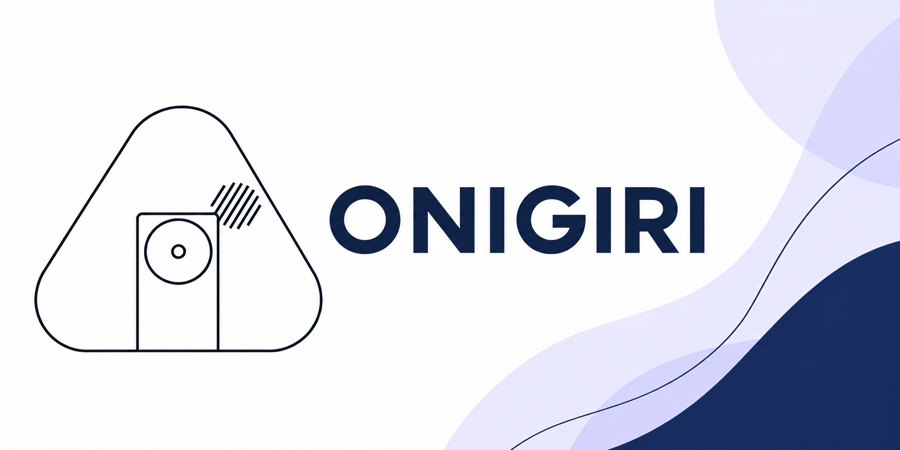

# Onigiri

<p align="center">
  
</p>

> **Plataforma aberta de robótica assistiva, em desenvolvimento, construída com componentes comerciais e arquivos próprios compartilhados publicamente.**

O Onigiri é mais do que um conjunto de códigos. É uma plataforma aberta que
reúne mecânica, eletrônica, software, documentação, CAD e testes para criar um
robô-guia acessível, adaptável e reproduzível. O projeto usa componentes
comerciais, como Raspberry Pi 4, HAT de motores e LiDAR; eles não se tornam
hardware aberto por integrarem o Onigiri.

O objetivo é apoiar a orientação de pessoas em empresas, escolas, supermercados, eventos e projetos acadêmicos. No cenário final, uma pessoa poderá solicitar um destino por voz, acompanhar o robô com segurança e receber uma confirmação ao chegar ao local.

## Estado do projeto

O projeto está em desenvolvimento. O repositório reúne a construção, a
implantação e as integrações planejadas, mas ainda existem testes físicos,
ajustes de segurança e bugs a corrigir antes de qualquer uso autônomo real.

### Recursos presentes no repositório

- Tração com três motores DC: frente, ré, giro e deslocamento lateral.
- Controle remoto por Logitech F710 em computador do operador (Windows, macOS ou Linux), usando rede Tailscale.
- RPLIDAR A1M8 publicando leituras no ROS 2.
- Proteção LiDAR a 35 cm para frente, ré e deslocamentos laterais implementada.
- Autonomia reativa experimental para parar e desviar de obstáculos.
- Prioridade para o controle manual.
- Inicialização automática no Raspberry Pi por serviços `systemd`.
- Primeiro mapa experimental gerado com `slam_toolbox`.
- Painel local que abre o mapa ROS 2 (`.yaml` + `.pgm`) e transforma um ponto
  livre selecionado no mapa em coordenadas para o cadastro de destinos.
- Fluxo preparado para voz offline, destinos nomeados, chegada, espera e retorno
  à base, dependente de mapa, localização e Nav2 configurados.

> Consulte [Estado, testes e limitações](docs/ESTADO_TESTES_E_LIMITACOES.md)
> antes de energizar ou movimentar uma unidade.

## Plataforma

| Camada | Componentes atuais |
|---|---|
| Computação | Raspberry Pi 4, Ubuntu 24.04 e ROS 2 Jazzy |
| Tração | 3 motores JGY370 12 V, 40 RPM e Stepper Motor HAT v0.2 |
| Percepção | RPLIDAR A1M8 |
| Visão e voz | Webcam UVC com microfone integrado |
| Alimentação | LiPo 3S 11,1 V e conversor Tobsun EA75-5V |
| Controle | Logitech F710 em computador do operador via Tailscale |
| Projeto mecânico | Modelo CAD em STEP compartilhado neste repositório |

## Estrutura do repositório

```text
cad/                    Modelo 3D compartilhado do robô
deploy/systemd/          Serviços de inicialização do Raspberry Pi
docs/                    Manual, especificação e arquitetura
software/raspberry/     Controle de motores e autonomia em ROS 2
software/operator_client/ Cliente multiplataforma e ferramentas do Logitech F710
software/admin_web/       Painel local para cadastrar destinos e frases de voz
config/                 Destinos nomeados e ponto de retorno
CHANGELOG.md             Registro das atualizações do projeto
```

## Comece pelos documentos

- [Manual de construção e operação](docs/MANUAL_DE_CONSTRUCAO.md)
- [Guia de construção do zero](docs/GUIA_DE_CONSTRUCAO_DO_ZERO.md)
- [Estado, testes e limitações](docs/ESTADO_TESTES_E_LIMITACOES.md)
- [Especificação de produto](docs/ESPECIFICACAO_DE_PRODUTO.md)
- [Arquitetura da plataforma](docs/ARQUITETURA.md)
- [Integração do botão de emergência](docs/BOTAO_DE_EMERGENCIA.md)
- [Missões, destinos e interação por voz](docs/MISSOES_E_DESTINOS.md)
- [Painel web de destinos](software/admin_web/README.md)
- [Roteiro de teste local do painel](docs/TESTE_PAINEL_DE_DESTINOS.md)
- [Modelo CAD em STEP](cad/README.md)
- [Referências técnicas](docs/REFERENCIAS_TECNICAS.md)
- [Registro de versões](CHANGELOG.md)

## Segurança

- Desligue a bateria LiPo antes de alterar cabos, motores ou o HAT.
- Não conecte outro carregador ou fonte USB-C ao Raspberry enquanto o Tobsun o estiver alimentando.
- Antes de testar, mantenha pessoas, cabos e objetos fora da área de movimento.
- O LiDAR e o software são camadas de proteção. Eles não substituem supervisão humana nem um corte físico de alimentação.
- O [botão de parada de emergência](docs/BOTAO_DE_EMERGENCIA.md) está planejado para cortar fisicamente a tração dos motores.

## Contribuição

O Onigiri evolui por meio de testes, documentação e colaboração. Ao contribuir, registre o que foi alterado, como foi validado e quais limitações ainda permanecem.

## Licenças

- O código, serviços e scripts usam a [licença MIT](LICENSE).
- O CAD e o hardware original usam a [CERN-OHL-S v2](LICENSE-HARDWARE.md).

Essas licenças mantêm o software reutilizável e exigem que derivações do
hardware continuem abertas.

Elas se aplicam somente aos arquivos originais do projeto. Raspberry Pi,
RPLIDAR, HAT de motores e demais produtos de terceiros permanecem sujeitos às
licenças e condições de seus fabricantes.

## Plataformas e operação ROS 2

Veja [Operação robótica](docs/OPERACAO_ROBOTICA.md) para Sabertooth, tank, Onigiri com omniball, mecanum, Gemini 2, navegação e imagem SD experimental. Os testes de software não substituem o comissionamento físico.

### Mesmo painel em outros chassis

Selecione omniball, esteiras ou mecanum, Raspberry 4/5 e controlador em Configurações. [Robô com Gemini 2 sem LiDAR](docs/ROBO_RGBD.md) usa os mesmos mapas e destinos, com odometria visual e banco RTAB-Map persistido.
